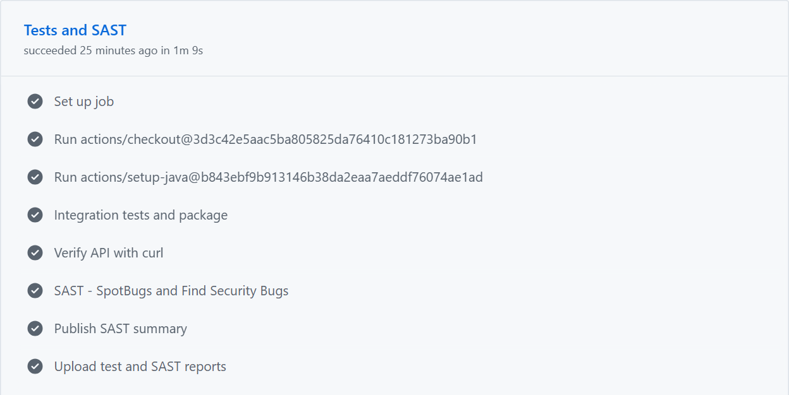
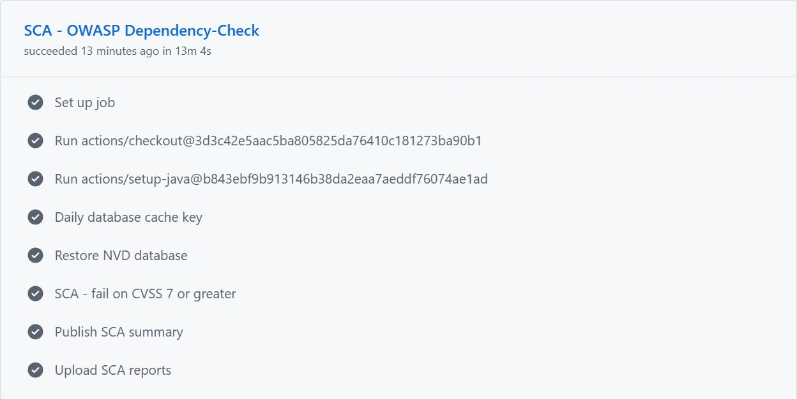
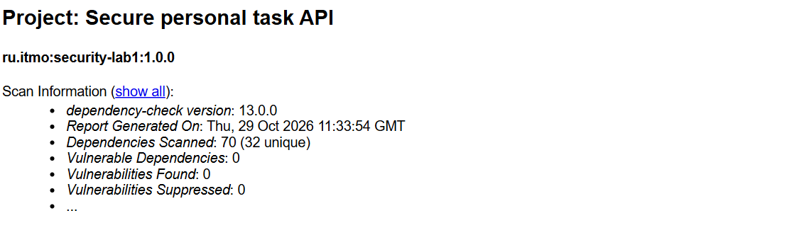

# Лабораторная работа № 1: защищённое REST API

Приложение для просмотра личных задач и изменения их статуса. Используются Java 21, Spring Boot 4.1.2, Spring Security, JDBC и база H2. Данные хранятся в памяти и сбрасываются при перезапуске.

## Запуск

Нужен JDK 21. В PowerShell из папки проекта выполните:

```powershell
$env:JAVA_HOME = 'C:\Program Files\Java\jdk-21'
.\scripts\start-demo.ps1
```

Приложение доступно по адресу http://127.0.0.1:8080. Учебные пользователи: anna с паролем AnnaDemo2026! и ivan с паролем IvanDemo2026!. Скрипт задаёт пароли через переменные окружения и создаёт случайный ключ JWT. В базе сохраняются только хэши паролей. Для Linux есть скрипт scripts/start-demo.sh.

## API

| Метод | Путь | Доступ | Назначение |
|---|---|---|---|
| POST | /auth/login | Открытый | Получить JWT |
| GET | /api/data | Bearer JWT | Просмотреть свои задачи |
| PATCH | /api/data/{id}/status | Bearer JWT | Изменить статус своей задачи |

Для входа отправьте запрос:

```http
POST /auth/login
Content-Type: application/json

{"username":"anna","password":"AnnaDemo2026!"}
```

Из ответа возьмите accessToken и передавайте его в заголовке защищённых запросов:

```http
GET /api/data
Authorization: Bearer <accessToken>
```

Изменение статуса задачи:

```http
PATCH /api/data/1/status
Authorization: Bearer <accessToken>
Content-Type: application/json

{"status":"DONE"}
```

Допустимые статусы: OPEN, IN_PROGRESS и DONE. Без действительного токена API возвращает 401, при неверном статусе — 400, при попытке изменить чужую задачу — 404.

## Проверка в Postman

Импортируйте коллекцию postman/lab1.postman_collection.json и окружение postman/local.postman_environment.json. В окружении заполните annaPassword и ivanPassword паролями из раздела «Запуск». Выберите это окружение и выполните запросы по порядку через Run collection.

Коллекция проверяет вход, отказ без токена, получение задач, изменение статуса, SQL-инъекцию, экранирование XSS и запрет изменения чужой задачи. Токены сохраняются автоматически после входа. У anna две задачи, у ivan — одна. Одна задача содержит строку со script для проверки XSS.

## Реализованные меры защиты

### SQL-инъекции

В Database.java используются запросы JdbcTemplate с параметрами «?». Логин, идентификаторы и статус передаются отдельно от SQL. Поэтому введённая строка не может изменить структуру запроса.

### XSS

Строковые поля задач экранируются через HtmlUtils.htmlEscape при формировании ответа. Например, тег script возвращается как текст. В базе остаются исходные значения, поэтому повторного экранирования нет.

### Аутентификация и доступ

Пароли хэшируются BCrypt. После успешного входа сервер выдаёт JWT на 15 минут. Ключ подписи берётся из LAB_JWT_SECRET. Spring Security проверяет подпись, срок действия, издателя и аудиторию токена на защищённых маршрутах.

Задачи выбираются и изменяются только для владельца из JWT. Клиент не может передать другого владельца. Приложение работает без сессий; токен передаётся в заголовке Authorization. Поэтому CSRF-защита для этого API отключена.

## Проверки в GitHub Actions

Pipeline запускается при push и pull request. В нём выполняются тесты, SAST и SCA. Отчёты сохраняются в артефактах запуска.

### SAST: SpotBugs и Find Security Bugs

Проверка завершилась успешно. Предупреждений вне исключений нет. В config/spotbugs-exclude.xml объяснены исключения для внедрения Spring-компонентов, списка маршрутов и отключения CSRF в API с Bearer-токенами.



### SCA: OWASP Dependency-Check

Сканер проверяет зависимости по базе NVD и блокирует сборку при CVSS от 7.0. Проверка завершилась успешно, уязвимости не обнаружены. Подавления CVE не используются.




